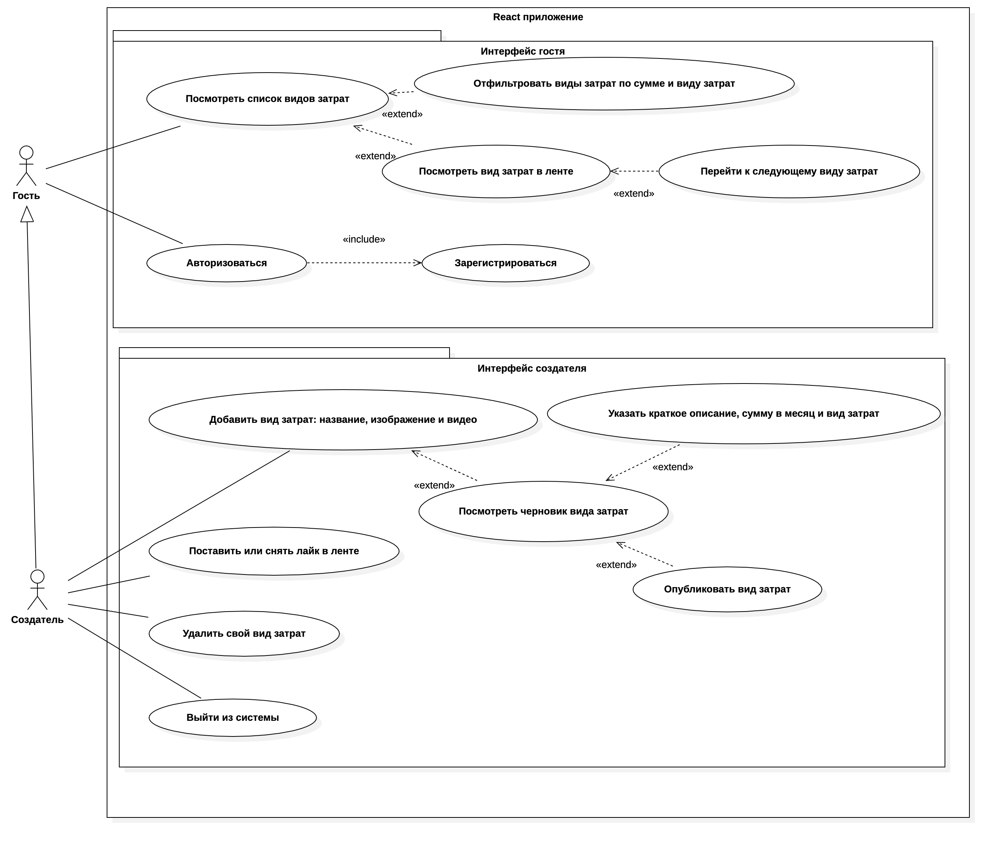

# Расчёт точки безубыточности нового продукта — фронтенд (ЛР6)

SPA на React + TypeScript + Vite + React-Bootstrap. «Услуга» в предметной области — **вид затрат** (операционные расходы, фонд оплаты труда, себестоимость продаж и т. д.).

В ЛР6 приложение работает с веб-сервисом: состояние хранится в Redux Toolkit, запросы к услугам идут через thunk и код, сгенерированный из Swagger. Есть вход и выход, добавление услуги, удаление и лайки. Если сервис недоступен, гость видит данные из коллекции mock-объектов.

Роли: **гость** (без входа) и **создатель** — авторизованный пользователь, который добавляет, публикует и удаляет свои виды затрат и ставит лайки.

## Запуск

```bash
npm install
npm run dev            # http://localhost:3000
npm run build          # проверка типов (tsc) и production-сборка в dist/
npm run generate:api   # заново сгенерировать src/api/Api.ts (веб-сервис должен быть запущен)
```

Веб-сервис запускается из репозитория бэкенда (ветка `lab-4-break-even-auth`):

```bash
docker compose up -d
go run ./cmd/Break-Even_Point_Calculation_for_a_New_Product   # http://localhost:8080
```

Тестовые пользователи: `ivanov`, `petrov`, `sidorova`, пароль у всех `123456`. У `sidorova` в начальных данных есть черновик.

## Страницы приложения

### 1. Плитка «Виды затрат» — `/cost-types`

Стартовая страница: адрес `/` открывает её. Доступна всем.

| Элемент | Тип | Что делает |
|---|---|---|
| Кнопка «Корзина» | `Button` с иконкой | у гостя неактивна; у создателя показывает наличие черновика и ведёт на «Добавление» |
| «Постоянные», «Переменные» | чекбоксы `Form.Check` | фильтр по виду затрат (`is_fixed`); если отмечены оба или ни одного, показываются все |
| «От» / «До» | двойной ползунок, 0–8 000 000 ₽, шаг 50 000 ₽ | диапазон суммы в месяц (`min_amount`, `max_amount`) |
| «Применить» | кнопка `Button` | запрашивает список с фильтром из Redux (thunk `fetchCosts`) |
| «Сбросить» | кнопка-ссылка | очищает поля фильтра и показывает все карточки |
| Карточка | `Card` | изображение, название, сумма, вид затрат, число лайков; клик открывает ленту `/feed/:id` |
| «Удалить» | кнопка на карточке | только у своих карточек создателя (`is_mine = 1`); после подтверждения удаляет услугу |

Значения полей фильтра хранятся в Redux (срез `filters`) и меняются сразу при каждом действии с галочкой или ползунком. Поэтому поля **сохраняют значения при переходе между страницами**, даже если «Применить» ещё не нажата. Список обновляется по «Применить», при открытии страницы и при входе или выходе.

### 2. Лента — `/feed` и `/feed/:id`

Карточка вида затрат на весь экран. Адрес `/feed` открывает первую карточку. Доступна всем.

| Элемент | Тип | Что делает |
|---|---|---|
| Фоновое видео | `<video>`, без звука, по кругу | видео услуги; если поле пустое или файл недоступен — видео по умолчанию |
| «Ещё» / «Свернуть» | кнопка | раскрывает длинное описание |
| «Сумма», «Вид затрат» | плашки | сумма в месяц и вид затрат |
| «Лайк» со счётчиком | круглая кнопка | у гостя неактивна; создатель ставит или снимает лайк |
| «Поделиться» | круглая кнопка | копирует ссылку на карточку |
| «Далее» | круглая кнопка | следующая карточка; после последней — снова первая |

Если вида затрат нет или он удалён (например, `/feed/4`), выводится «Вид затрат не найден или удалён».

### 3. Добавление — `/addition`

Только для создателя: гостя перенаправляет на страницу входа. Шаг зависит от того, есть ли черновик.

| Шаг | Поля | Кнопка |
|---|---|---|
| Черновика нет | «Фото», «Видео» (файлы с предпросмотром), «Название вида затрат» | «Далее» создаёт черновик и загружает файлы в MinIO |
| Черновик есть | фото и видео черновика, название (только чтение), «Краткое описание», «Сумма затрат», флажок «Постоянные затраты» | «Опубликовать» публикует услугу и открывает плитку |

### 4. Вход — `/login`

| Элемент | Что делает |
|---|---|
| «Логин», «Пароль» | поля формы |
| «Войти» | `axios.post('/api/users/login')` прямо в компоненте, JWT в `localStorage`, `dispatch(setUser)`; открывает плитку |
| Сообщение об ошибке | «Неверный логин или пароль» или «Сервис недоступен» |

### Навигационная панель

| Пункт | Гость | Создатель |
|---|---|---|
| Лента | доступен | доступен |
| Добавление | неактивен, подсказка «Доступно после входа» | доступен |
| Виды затрат | доступен | доступен |
| Вход / Выход | «Вход» | «Выход»: `axios.post('/api/users/logout')`, удаляет JWT и сбрасывает фильтр |

Пока выполняется запрос, на весь экран показывается анимация (`LoadingOverlay`), которая блокирует все кнопки.

## Состояние Redux

| Срез | Поля | Как меняется |
|---|---|---|
| `user` | `isAuth`, `username`, `authPending`, `sessionExpired` | вручную: `setUser`, `clearUser`, `setAuthPending` |
| `filters` | `kinds`, `minAmount`, `maxAmount` — значения полей фильтра | `setFilters` при каждом изменении поля, `resetFilters`; сбрасывается по `clearUser` |
| `costs` | `list`, `listStatus`, `feedCost`, `feedStatus`, `draft`, `pendingCount`, `error`, `usingMock` | через thunk |

## Обращения к веб-сервису

**Услуги** — thunk (`src/store/costsSlice.ts`) и клиент Axios, сгенерированный из Swagger (`src/api/Api.ts`):

| Thunk | Сгенерированный метод | Запрос |
|---|---|---|
| `fetchCosts` | `api.api.breakevenPointList` | `GET /api/breakeven_point` |
| `fetchFeedCost` | `api.api.breakevenPointFeedList` | `GET /api/breakeven_point/feed` |
| `fetchDraft` | `api.api.breakevenPointDraftList` | `GET /api/breakeven_point/draft` |
| `createCost` | `api.api.breakevenPointCreate` | `POST /api/breakeven_point` |
| `publishCost` | `api.api.breakevenPointPublishUpdate` | `PUT /api/breakeven_point/:id/publish` |
| `deleteCost` | `api.api.breakevenPointDelete` | `DELETE /api/breakeven_point/:id` |
| `likeCost` | `api.api.breakevenPointLikeCreate` | `POST /api/breakeven_point/:id/like` |

**Вход и выход** — только axios, без кодогенерации и thunk, прямо в компонентах: `axios.post('/api/users/login')` в `LoginPage`, `axios.post('/api/users/logout')` в `AppNavbar`. Результат передаётся в Redux вручную (`setUser`, `clearUser`). `src/modules/authApi.ts` только хранит JWT.

**Прокси** (`vite.config.ts`) решает ограничение CORS: браузер обращается только к `:3000`.

| Адрес в браузере | Куда идёт запрос |
|---|---|
| `/api/...` | `http://localhost:8080/api/...` |
| `/s3/<бакет>/<файл>` | `http://localhost:9000/<бакет>/<файл>` (MinIO) |

**Mock** (`src/modules/mock.ts`): если сервис недоступен (нет ответа или код 5xx), гость получает плитку и ленту из коллекции `COSTS_MOCK`, а на странице появляется плашка. Создатель mock не получает, он видит сообщение об ошибке.

**Токен.** JWT сохраняется в `localStorage` (ключ `access_token`), а запросы берут его из памяти клиента (`setSecurityData`). Поэтому после F5 Redux и запросы снова гостевые, а токен остаётся во вкладке Application, откуда его можно взять для Postman. Следующий вход заменяет токен, выход удаляет его и отзывает на бэкенде.

## Диаграмма прецедентов

Роли — гость и создатель. Создатель наследует прецеденты гостя (обобщение от «Создатель» к «Гость»).



## Порядок показа

| Скриншоты | Что показать |
|---|---|
| 1–2 | Веб-сервис остановлен: плитка и лента на mock, видна плашка |
| 3–6 | Сервис запущен: лента, плитка, вход, добавление |
| 7–8 | Изменить строку в Adminer (`localhost:8081`), нажать «Применить» на плитке |
| 9 | Войти, нажать F5: в DevTools `user.isAuth = false`, в Application → Local Storage остался `access_token` |
| 10 | В Postman: `GET http://localhost:8080/api/breakeven_point` с заголовком `Authorization: Bearer <токен>`, в ответе `is_mine: 1` |
| 11–12 | Код срезов `src/store/*Slice.ts`; axios в `src/api/Api.ts` и вызов входа в `LoginPage.tsx` |
| 13–14 | Thunk в `src/store/costsSlice.ts` с вызовами `api.api.breakevenPoint*` |
| 15–16 | Network: запросы на `localhost:3000/api/...`; картинки `/s3/media/...` и `/s3/break-even/...` |

## Структура

```
src/
  main.tsx              точка входа: Provider и <App/>
  App.tsx               роутинг, доступ гостя и создателя к страницам
  AppLayout.tsx         оболочка: колонка 390px + <Outlet/> + navbar + анимация загрузки
  Routes.ts             маршруты и подписи меню
  api/
    Api.ts              клиент Axios, сгенерированный из Swagger (не редактировать вручную)
    index.ts            единственный экземпляр клиента
  store/
    index.ts            configureStore, selectIsBusy
    hooks.ts            типизированные useAppDispatch и useAppSelector
    userSlice.ts        состояние авторизации
    filtersSlice.ts     значения полей фильтра услуг
    costsSlice.ts       услуги и все thunk
  modules/
    authApi.ts          хранение JWT в localStorage (запросы входа и выхода — в LoginPage и AppNavbar)
    toCost.ts           ответ веб-сервиса -> объект Cost
    mock.ts             mock-коллекция и её фильтрация
    types.ts            интерфейсы Cost и CostFilters
    media.ts            медиа по умолчанию, адреса через прокси /s3
    format.ts           форматирование сумм, подписи видов затрат
  components/           AppNavbar, Breadcrumbs, CartIcon, CostCard, CostFilter, LoadingOverlay, StatusBanner
  pages/                CostTypesPage, FeedPage, AdditionPage, LoginPage
public/
  default-image.png, default-video.mp4   медиа по умолчанию
  mock/*.png                              обложки mock-карточек
docs/
  use-case.png                            диаграмма прецедентов (экспорт из StarUML)
```

## Задание ЛР6

- **Цель:** завершение интерфейса пользователя в React.
- **Задание:** внедрить менеджер состояний для хранения значений фильтров, добавить авторизацию и возможность создания услуг через Redux Toolkit и redux-thunk, кодогенерацию взаимодействия с API через Axios.
  - Содержимое карточек получать из веб-сервиса, CORS решить через проксирование (для S3 — второй маршрут).
  - При отсутствии доступа к бэкенду получать данные из mock-коллекции (только как гость).
  - Фильтры добавлять в запрос к бэкенду.
  - Страница добавления услуги, кнопки удаления и лайков, страница авторизации.
  - Переключение между интерфейсом гостя и пользователя по кнопке Вход/Выход; при выходе сбрасывать фильтр.
  - При запросах показывать анимацию, блокирующую кнопки.
  - Запросы авторизации и деавторизации — только axios, состояние передавать в Redux вручную.
- **Контрольные вопросы:** схема redux-toolkit (reducer, store, middleware), axios, local storage, CORS и обратный прокси, BFF и GraphQL, Next.js и SSG, FSD.
- **Диаграмма:** диаграмма прецедентов интерфейса React.
